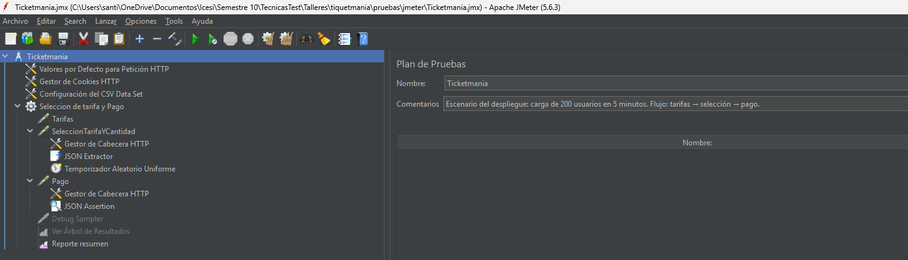
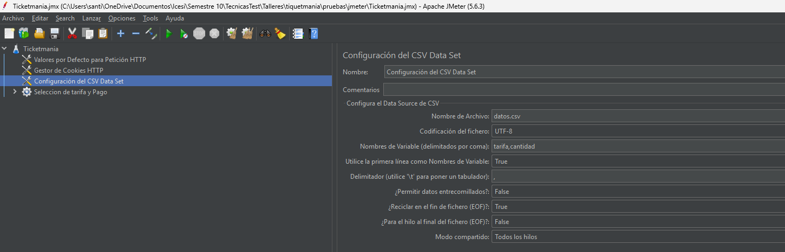
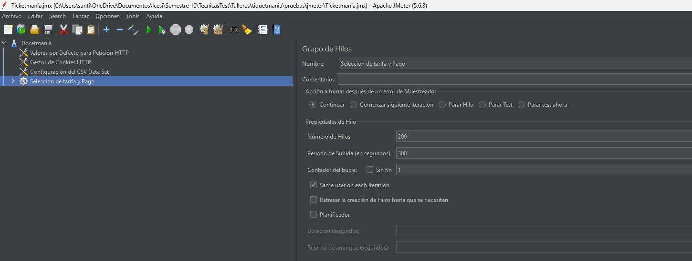
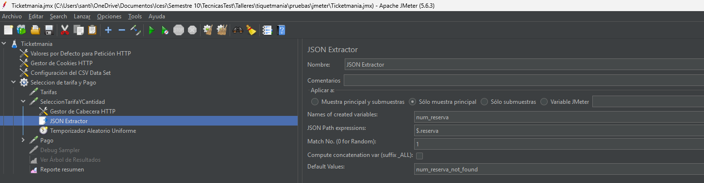
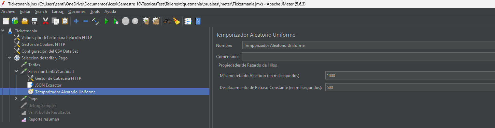
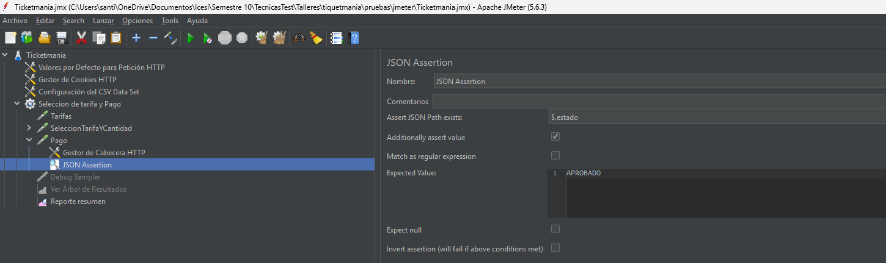

# Tiquetmania · Pruebas de rendimiento con JMeter

Monorepo con la API de Tiquetmania y sus pruebas de rendimiento. El pipeline de GitHub Actions levanta la API y ejecuta el plan de JMeter sobre el mismo commit.

```text
tiquetmania/
├── api/
│   └── ticketmania_simple.py          API del taller (Python 3.8+, sin dependencias)
├── pruebas/
│   ├── jmeter/                        Plan del despliegue (lo ejecuta el pipeline)
│   │   ├── Ticketmania.jmx
│   │   └── datos.csv                  misma carpeta que el .jmx (ruta relativa)
│   └── experimentacion/               Planes de "¿Qué pasaría si...?" (NO los ejecuta el pipeline)
│       ├── P01 ... P10 .jmx           un plan por pregunta
│       └── datos*.csv
└── .github/workflows/rendimiento.yml  Pipeline
```

## Plan del despliegue (`pruebas/jmeter/Ticketmania.jmx`)

```text
Ticketmania (Plan de Pruebas)
├── Valores por Defecto para Petición HTTP   127.0.0.1:8080
├── Gestor de Cookies HTTP
├── Configuración del CSV Data Set           datos.csv → ${tarifa}, ${cantidad}
└── Seleccion de tarifa y Pago (Grupo de Hilos: 200 hilos, subida 300 s, bucle 1)
    ├── Tarifas                     GET  /api/tarifas
    ├── SeleccionTarifaYCantidad    POST /api/seleccion  {"tarifa":"${tarifa}","cantidad":${cantidad}}
    │   ├── Gestor de Cabecera HTTP          Accept y Content-Type: application/json
    │   ├── JSON Extractor                   $.reserva → ${num_reserva}
    │   └── Temporizador Aleatorio Uniforme  500 ms + hasta 1000 ms (500 a 1500 ms)
    ├── Pago                        POST /api/pago  {"reserva":"${num_reserva}"}
    │   ├── Gestor de Cabecera HTTP
    │   └── JSON Assertion                   $.estado = APROBADO
    ├── Debug Sampler                (deshabilitado: solo para depurar)
    ├── Ver Árbol de Resultados      (deshabilitado: solo para depurar)
    └── Reporte resumen
```

El plan no usa plugins, así que abre igual en el pipeline que en un JMeter recién instalado.

### Capturas del plan en JMeter 5.6.3

| Elemento | Captura |
|---|---|
| Árbol del plan |  |
| CSV Data Set: ruta relativa `datos.csv` |  |
| Grupo de Hilos: 200 hilos, subida 300 s, bucle 1 |  |
| JSON Extractor: `$.reserva` → `num_reserva` |  |
| Temporizador Aleatorio Uniforme: 500 a 1500 ms |  |
| JSON Assertion: `$.estado` = `APROBADO` |  |

### Prueba en local

Con la API encendida y desde `pruebas/jmeter/`, el mismo comando del pipeline dio **600 muestras y 0 fallidas** (200 de cada petición; media de 2,0 ms en Tarifas, 2,1 ms en Selección y 1,6 ms en Pago), en los 5 minutos del escenario.

## Ejecutar en local

```bash
python api/ticketmania_simple.py                 # deja la API en http://127.0.0.1:8080
cd pruebas/jmeter
jmeter -n -t Ticketmania.jmx -l resultados.jtl -e -o reporte
```

Abre `pruebas/jmeter/reporte/index.html`.

## Pipeline (`.github/workflows/rendimiento.yml`)

Un solo job, `prueba-rendimiento`, que se dispara con un push a `main` o a mano (`workflow_dispatch`):

1. Descarga el repositorio.
2. Instala Java 17.
3. Instala JMeter 5.6.3 y agrega `bin/` al PATH con `$GITHUB_PATH`. Lo descarga del CDN de Apache (`dlcdn.apache.org`), verifica su SHA-512 y lo guarda en caché, así las ejecuciones siguientes no lo vuelven a descargar. La primera versión lo bajaba de `archive.apache.org`, que limita la velocidad: ese paso tardó unos 20 minutos.
4. Levanta la API en el puerto 8080 en segundo plano.
5. Espera a que `/api/salud` responda.
6. Ejecuta el plan en modo no-GUI desde `pruebas/jmeter/`, con `.jtl` y reporte HTML.
7. Revisa el `.jtl`: si alguna muestra tiene `success=false`, el job termina en rojo (JMeter por sí solo no falla cuando una petición responde mal).
8. Sube el reporte como artefacto `reporte-rendimiento`, con `if: always()`.

En GitHub Actions la API y JMeter comparten la misma máquina virtual: el pipeline comprueba que la carga corre de principio a fin, no mide la capacidad de la API.

## Experimentación

Los planes de `pruebas/experimentacion/` (uno por pregunta, P01 a P10) son los del taller "¿Qué pasaría si...?". El pipeline no los ejecuta. El documento de entrega, los resultados, los reportes y los scripts de medición están en el repositorio [Taller_Experimentacion](https://github.com/Santiago-Cardenas/Taller_Experimentacion).
